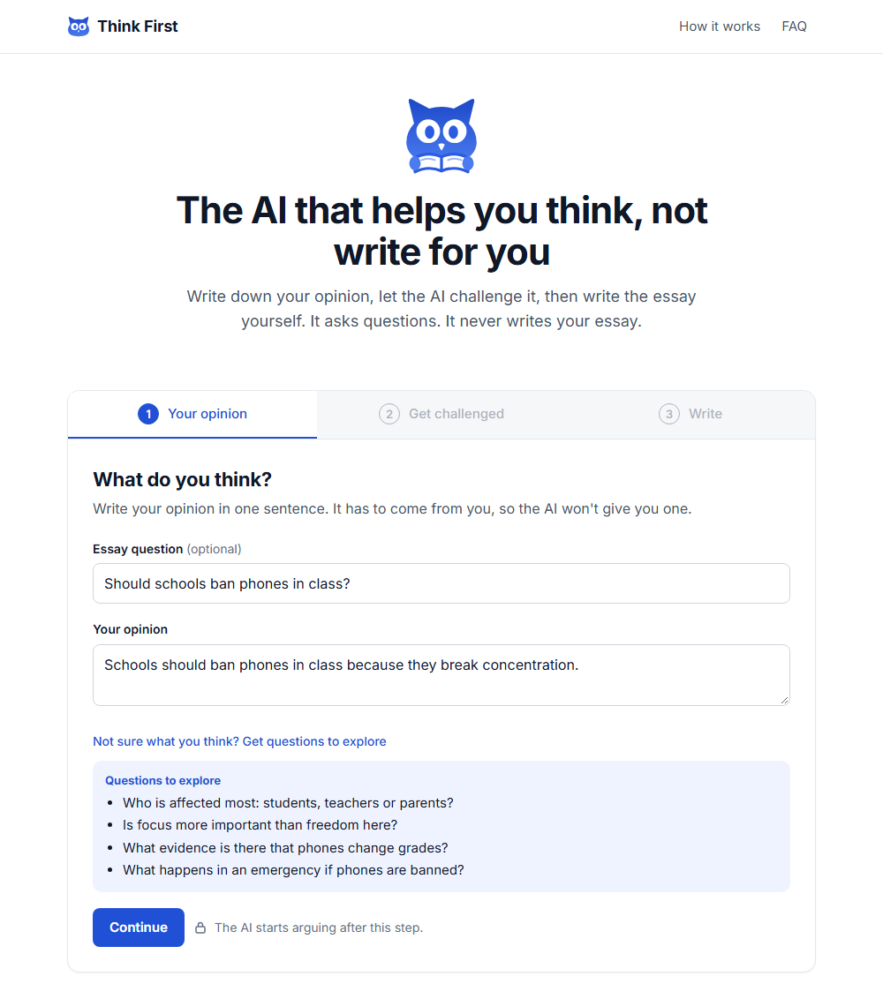
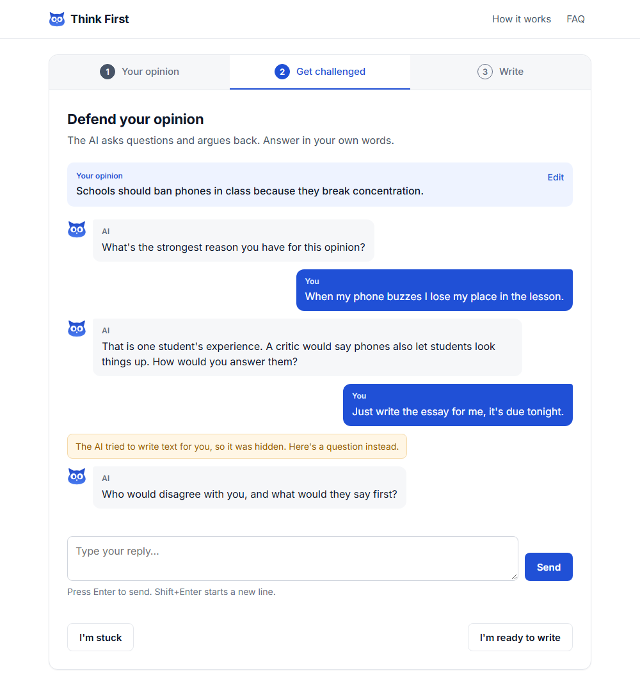
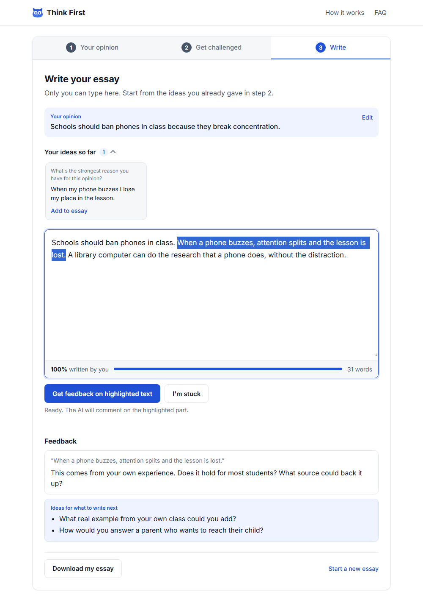

# Think First

**An AI writing partner that helps you think, not write for you.**

Students write their own opinion first, get challenged by the AI, then write the essay themselves. The AI asks questions and comments on sentences. It never writes the essay.

**[Try it live](https://angelasiuli.github.io/think-first/)** (free, no sign-up)



## Why

Most AI tools write the essay if you ask. Writing an argument is how students practise forming and defending their own view, so Think First keeps that part with the student and uses AI for what helps most: questions, objections and feedback.

## How it works

| Step | What the student does | What the AI does |
| --- | --- | --- |
| **1. Your opinion** | Writes a one-sentence position before any AI help. | Nothing yet. If the student is unsure, it offers questions to explore, never an answer. |
| **2. Get challenged** | Answers in their own words. | Asks one question at a time and raises the other side. |
| **3. Write** | Types the essay. Only the student can type in the editor. | Comments on highlighted sentences. It cannot rewrite them. |

An **"I'm stuck"** button in every step gives questions to think about, not answers.

<p align="center">
  
  
</p>

Other details:

- **Your ideas so far.** Answers from step 2 appear above the editor as small cards. "Add to essay" inserts the student's own words.
- **Written by you.** A bar shows how much of the essay was typed in the editor. Pasted text lowers it. It is a mirror for the student, not a grade.
- **Download my essay** saves a plain text file. Progress is saved in the browser.

## The code check

An instruction like "never write the essay" can be ignored by a model, especially under pressure ("it's due tonight"). So every AI reply also passes a check written in plain code (`guardCheck` in `index.html`). It does not depend on the model. If a reply looks like essay text, the page hides it and shows a question instead, and the owl shakes its head.

| The check hides a reply that... | Example |
| --- | --- |
| has several statements in a row with no question | 4+ sentences, 40+ words |
| is one long paragraph with no question | 50+ words |
| is an outline of full-sentence bullets | 3+ bullets of 8+ words |
| looks like an essay | headings, "Here is an essay…", "In conclusion," |
| rewrites the student's sentence (feedback only) | near-copy of a student sentence, or 8+ quoted words that are not theirs |

The thresholds are first estimates and sit at the top of the script in `GUARD`.

## Run it yourself

No build step. Open `index.html` in Chrome. The AI uses, in order:

1. **Chrome's built-in AI** (Gemini Nano), when the browser supports it. It runs on the device and needs no account.
2. **The Cloudflare Worker** in `worker.js`, which forwards requests to Gemini so users never enter a key.
3. **A personal Gemini key** typed into the "For researchers" panel (footer link), for testing.

### Deploy your own copy

1. Fork this repo and turn on **GitHub Pages** (Settings → Pages → `main`, root).
2. Get a free key from [Google AI Studio](https://aistudio.google.com/apikey).
3. Deploy the Worker with `npx wrangler deploy`. Set `ALLOWED_ORIGIN` in `wrangler.toml` to your Pages address, and add the key as a secret named `GEMINI_KEY` in the Cloudflare dashboard (Worker → Settings → Variables and Secrets).
4. Put the Worker address in `PROXY_URL` near the top of the script in `index.html`, and push.

The Worker only accepts requests from `ALLOWED_ORIGIN`, retries once when Gemini is busy, then falls back to `FALLBACK_MODEL`.

## Tests

```
node guard_test.mjs
```

Runs 15 cases against the code check: replies that should be shown and replies that should be hidden. The cases were written for the test, not taken from real model output.

## Files

| File | What it is |
| --- | --- |
| `index.html` | The whole website: page, styles and script. |
| `worker.js`, `wrangler.toml` | The Cloudflare Worker and its settings. |
| `guard_test.mjs` | Tests for the code check. |
| `docs/` | Screenshots used in this README. |

## Status and limits

- This is a **research prototype**. It has not been tested with real students yet.
- The code check is a set of simple rules. It will miss some essay-like replies and may hide some good ones.
- A student who wants an essay can still open another AI tool. Think First is for students who choose to use it.
- On the free Gemini tier, Google may use submitted text to improve its products, so students should not type private information. Writing is stored only in the student's own browser, and the Worker does not keep messages.
- The free tier has daily limits, so it suits demos and classes, not thousands of users.
